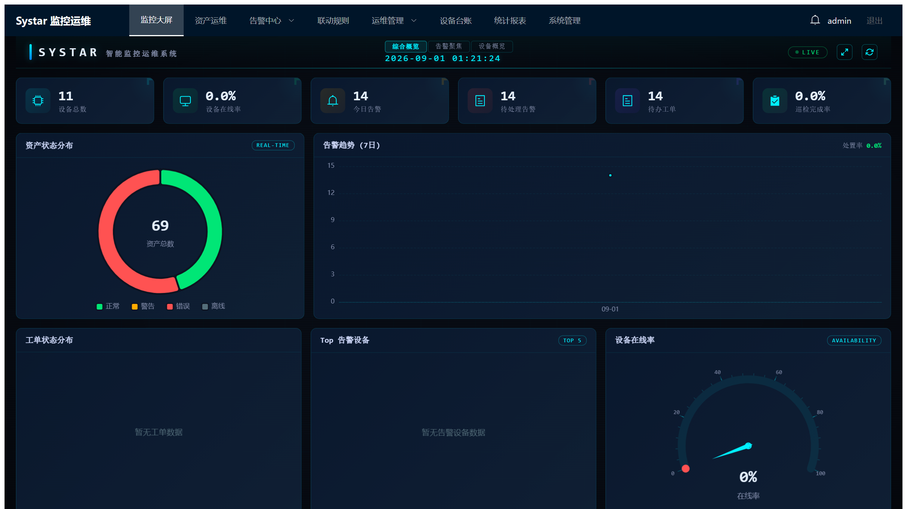
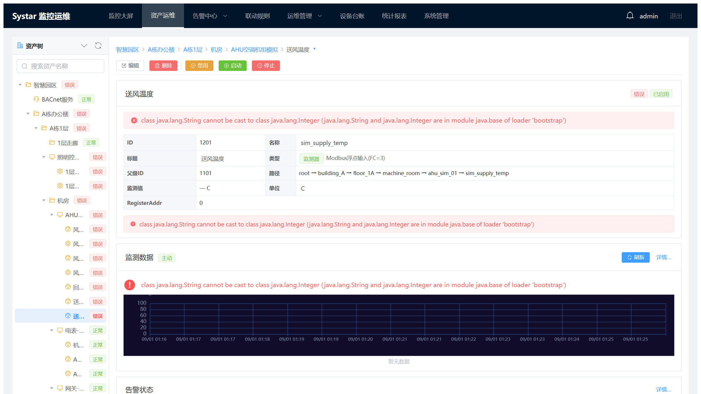
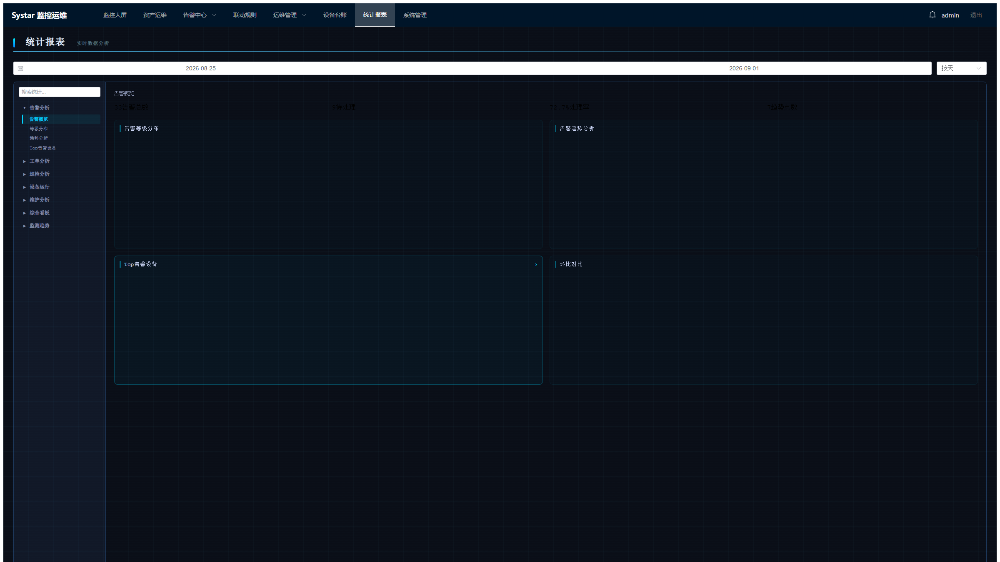

# Systar — Industrial IoT Monitoring & Operations Platform

English | [简体中文](README.zh-CN.md)

> **Status**: v1.1.1, active development. The end-to-end pipeline (acquisition → storage →
> alarming → linkage → control → statistics → operations → dashboard) is complete and
> covered by automated tests.

Systar is a general-purpose IoT monitoring and operations framework for smart campuses,
factory lines, energy management, data centers and similar environments. The monitoring
core is decoupled from the web layer and can be embedded as a standalone library.

## Screenshots

All screenshots show the demo dataset generated by the built-in simulator
(H2 development profile) — what you see right after following
[Getting Started](#getting-started).

**Monitoring dashboard** — KPI overview, device status distribution, realtime
alarms and live trends:



**Asset operations** — hierarchical asset tree, probe detail panel and the
interactive trend chart (pan / zoom / automatic granularity switching):



**Statistics reports** — alarm trends, type distribution and processing KPIs:



## System Highlights

Structural properties that matter if you plan to build on Systar:

**Self-contained driver plugins.** Each protocol is a plugin directory —
`driver.jar` + `lib/` + optional `seed/` CSV — discovered at startup under a
configurable search path (`systar.drivers.path`, default `./drivers`). Copy a
plugin directory in, restart, done: no server code change, no repackaging, and
removing one never breaks startup (affected rows are WARN-skipped by name).
Site-specific presets can be an XML-only plugin directory referencing another
plugin's driver class, extending the type catalog without writing Java. Each
plugin gets its own class loader, so private protocol libraries are isolated
per plugin. Malformed or duplicate type definitions fail fast at startup with
the offending plugin named. See the
[driver development guide](docs/driver-development-guide.md) and the
[type XML specification](docs/design/xml-asset-type-config-design.md).

**Embeddable monitoring core.** `systar-monitor-core` has no web dependency.
It defines its own repository interfaces (samples, alarms, linkages, scheduled
tasks) which `systar-data` implements, so the engine can run as a library
inside another application.

**One asset model.** Devices, services, probes and controls share a single
typed-property model with a defined resolution order (instance value → type
default → built-in default). Virtual probes (SpEL-derived metrics) and
user-defined group trees build on that same model instead of parallel ones.

**Write integrity in the storage layer.** Structural edits to group trees
(rename, move, reorder) run inside transactions that lock the tree row first,
so invariants — name uniqueness, cycle guards, atomic reordering — hold for
concurrent API clients, not just for the bundled UI.

**One schema contract, two databases.** MySQL and H2 scripts are maintained
in parallel trees and selected by a `DatabaseDialect` adapter
(`systar.database.type`), which is also the extension point for further
engines.

**Offline-friendly build.** The Maven wrapper lets the whole backend build and
test on an isolated intranet with `./mvnw clean test -o` once the local Maven
cache is primed; every dependency of this repository resolves from Maven Central.

## Features

- **Hierarchical asset modeling** — Devices and Services as top-level assets, with
  Probes (monitoring points) and Controls (actuation points) attached to Devices
- **Multi-protocol acquisition** — 12 MIT protocol driver plugins built in (Modbus TCP,
  OPC UA, SNMP, Siemens S7, MQTT, WebSocket, raw TCP/IP, UPS (SNMP), weather (HTTP API),
  environmental sensors (passive TCP), a built-in simulator and manual input),
  extensible to new protocols by dropping a plugin directory into the driver search
  path — supporting both active polling and passive reception. BACnet/IP and
  IEC 60870-5-104 are available as GPL-3.0 driver plugins (see [License](#license))
- **Virtual probes** — SpEL-derived metrics computed from other probes, with
  dependency tracking and cycle detection
- **Alarm engine** — three strategies (single, continuous, selective), severity levels
  and automatic recovery detection, plus alarm correlation and suppression
- **Linkage engine** — cause → effect automation rules triggered by monitor values or
  alarms
- **Scheduled control** — cron-driven tasks with a visual cron wizard in the UI
- **Realtime push** — WebSocket streaming of probe values and alarm messages
- **REST API** — asset CRUD, live/history data, control execution, alarm/linkage/schedule
  management, dashboard aggregation
- **Operations suite** — work orders, device ledger, inspection management, statistical
  reports, anomaly detection and health scoring
- **Dashboard** — ECharts-based KPI dashboard (asset status, online rate, alarm trends)
- **Data retention** — configurable automatic cleanup of aged samples
- **Dual database** — MySQL (production) and H2 (development/testing) selected by a
  dialect adapter

## Architecture

```
core/                          monitoring framework (usable standalone)
├── systar-common/             shared utilities (IDs, code dictionaries, config, TimeSpan)
├── systar-monitor-core/       monitoring engine (asset model, scheduling, result
│                              dispatch, alarms, linkage, virtual probes)
└── systar-data/               persistence layer (MyBatis-Plus entities/mappers,
                               repository implementations)
drivers/                       protocol driver plugins (one Maven module per protocol;
                               each builds to a self-contained plugin directory)
extensions/
├── systar-server/             Spring Boot entry point, REST API, configuration,
│                              lifecycle management
├── systar-websocket/          realtime push (probe values + alarm messages)
├── systar-ops/                operations business (work orders, device ledger,
│                              inspections, statistics)
└── systar-system/             administration (users, roles, menus, departments,
                              notices, logs)
simulator/                     synthetic fleet generator (random/sine/ramp/correlated
                               data profiles) for demos and load testing
frontend/                      Vue 3 single-page application
sql/                           MySQL + H2 schemas and seed data
```

Module dependency flow:

```
systar-server ──→ systar-websocket ──→ systar-monitor-core ──→ systar-common
systar-server ──→ systar-data ────────→ systar-monitor-core
systar-server ──→ systar-ops ──→ systar-data, systar-common
systar-server ──→ systar-system ──→ systar-data, systar-common

driver plugins ──→ systar-monitor-core (provided only; loaded at runtime from the
driver search path, no compile-time dependency on systar-server)
```

## Tech Stack

| Component | Version | Purpose |
|-----------|---------|---------|
| Java | 17 LTS | runtime |
| Spring Boot | 3.3.6 | application framework |
| MyBatis-Plus | 3.5.7 | ORM |
| MySQL | 8.x | production database |
| H2 | 2.3.232 | development / test database |
| Vue | 3.4 | frontend framework |
| Element Plus | 2.5 | UI component library |
| ECharts | 5.5 | charting |
| Pinia | 2.1 | state management |
| Vite | 5.4 | frontend build tooling |
| Hutool | 5.8.27 | utility library |

Build: Maven (multi-module, wrapper included — no local Maven install required).

## Getting Started

### Prerequisites

- JDK 17+
- Node.js 18+ (frontend development only)
- MySQL 8.x (production mode only — the dev profile runs on embedded H2, no setup needed)

### Run the backend (port 8081)

```bash
# H2 development profile — schema and seed data load automatically; the install
# step also builds driver plugins into drivers/dist/ (the dev driver search path)
./mvnw install -DskipTests
./mvnw spring-boot:run -pl extensions/systar-server -Dspring-boot.run.profiles=dev

# MySQL production mode — deployment layout: server jar + drivers/ plugin
# directory beside it (systar.drivers.path resolves against the working dir)
./mvnw clean package -DskipTests
mkdir -p deploy
cp extensions/systar-server/target/systar-server-1.1.1.jar deploy/
cp -r drivers/dist deploy/drivers
cd deploy && java -jar systar-server-1.1.1.jar
```

API base path: `http://localhost:8081/api/monitor` · WebSocket: `ws://localhost:8081/ws/monitor`

For a MySQL deployment, initialize databases first (once):

```bash
bash sql/mysql/init.sh      # Linux / macOS
sql\mysql\init.bat          # Windows
```

### Run the frontend (port 5173)

```bash
cd frontend
npm install
npm run dev
```

The dev server proxies API calls to `http://localhost:8081`.

### Helper scripts

`bin/` contains start/stop/build/init-database scripts for Windows (`.bat`) and
Linux/macOS (`.sh`), including one-shot `start-all` / `stop-all` combinations.

## Configuration

Key settings in `extensions/systar-server/src/main/resources/application.yml`:

| Environment variable | Purpose | Default |
|----------------------|---------|---------|
| `SYSTAR_SECRET` | JWT signing secret | `changeme-default-secret` |
| `SYSTAR_DB_PASSWORD` | MySQL password (both datasources) | `123456` |

Other notable keys: `systar.database.type` (`mysql` \| `h2`), `systar.drivers.path`
(driver plugin search directory, default `./drivers`, resolved against the working
directory), `systar.security.whitelist` (paths exempt from authentication), and the
separate statistics datasource (`systar.stats-datasource.*`).

> **Security notes**
> - The seed database ships an `admin` / `admin123` account — change it before exposing
>   the service to any network.
> - Always override `SYSTAR_SECRET` in production; the default value must never leave a
>   local development machine.

## Testing

```bash
./mvnw clean test -o      # full backend regression (offline mode)
cd frontend && npm test   # frontend unit tests
```

## REST API Overview

| Method | Path | Description |
|--------|------|-------------|
| GET | `/api/monitor/asset-tree` | asset forest (`tree=kind` by-type tree or group-tree id) |
| GET/POST/PUT/DELETE | `/api/monitor/group-trees` | group-tree CRUD |
| GET/POST/PUT/DELETE | `/api/monitor/groups` | group CRUD; PUT `/groups/{id}/assets` replaces members |
| GET/POST/PUT/DELETE | `/api/monitor/assets` | asset CRUD |
| PUT | `/api/monitor/assets/{id}/start\|stop\|enable\|disable` | runtime lifecycle control |
| GET | `/api/monitor/probe-values` | current probe values |
| GET | `/api/monitor/probe-history` | historical data (paged) |
| POST | `/api/monitor/control/{id}/execute` | execute a control command |
| GET/POST/PUT/DELETE | `/api/monitor/alarm-rules` | alarm rule management |
| GET | `/api/monitor/alarm-messages` | alarm messages (paged) |
| GET/POST/PUT/DELETE | `/api/monitor/correlation-rules` | alarm correlation rules |
| GET/POST/PUT/DELETE | `/api/monitor/escalation-policies` | alarm escalation policies |
| GET/POST/PUT/DELETE | `/api/monitor/linkage-rules` | linkage rule CRUD |
| GET/POST/PUT/DELETE | `/api/monitor/scheduled-tasks` | scheduled task CRUD |
| GET | `/api/monitor/dashboard` | dashboard aggregation |
| POST | `/api/auth/login` | login |
| GET/POST/PUT/DELETE | `/api/ops/work-orders` | work orders |
| GET/POST/PUT/DELETE | `/api/ops/device-ledger` | device ledger |
| GET/POST/PUT/DELETE | `/api/ops/inspection` | inspections |
| GET/POST/PUT/DELETE | `/api/ops/statistics` | statistical reports |
| GET | `/api/ops/trend` | trend data (adaptive granularity) |
| GET | `/api/ops/analysis` | anomaly detection & health scoring |
| GET/POST/PUT/DELETE | `/api/sys/user` | user management |
| GET/POST/PUT/DELETE | `/api/sys/role` | role management |
| GET/POST/PUT/DELETE | `/api/sys/menu` | menu management |
| GET/POST/PUT/DELETE | `/api/sys/dept` | department management |
| GET/PUT | `/api/sys/notice` | notices |
| GET | `/api/sys/log` | operation logs |
| GET/PUT | `/api/sys/data-retention` | data retention policy |

## Project Layout

```
systar/
├── core/                        monitoring core modules (see Architecture)
├── drivers/                     protocol driver plugin modules (see Architecture)
├── extensions/                  server & business modules (see Architecture)
├── simulator/                   synthetic data generator
├── frontend/                    Vue 3 application (views, components, composables, api)
├── sql/
│   ├── h2/{ddl,data}/           H2 schema + seed data
│   └── mysql/{ddl,data}/        MySQL schema + seed data, plus init.sh / init.bat
├── bin/                         start/stop/build/init scripts (Windows + Linux/macOS)
└── docs/                        documentation
```

## Documentation

| Document | Path |
|----------|------|
| Development roadmap | [docs/roadmap.md](docs/roadmap.md) |
| Technical overview | [docs/tech_overview.md](docs/tech_overview.md) |
| Requirements | [docs/requirements.md](docs/requirements.md) |
| Architecture design | [docs/design/architecture.md](docs/design/architecture.md) |
| Asset CRUD design | [docs/design/asset-crud-design.md](docs/design/asset-crud-design.md) |
| Statistics pipeline design | [docs/design/stats-pipeline-design.md](docs/design/stats-pipeline-design.md) |
| Operations statistics design | [docs/design/ops-statistics-design.md](docs/design/ops-statistics-design.md) |
| Virtual probe design | [docs/design/virtual-probe-design.md](docs/design/virtual-probe-design.md) |
| XML asset type configuration | [docs/design/xml-asset-type-config-design.md](docs/design/xml-asset-type-config-design.md) |
| Protocol driver development guide | [docs/driver-development-guide.md](docs/driver-development-guide.md) |
| Nginx deployment template | [docs/deployment/nginx-systar.conf](docs/deployment/nginx-systar.conf) |
| Frontend interaction test checklists | [docs/test/](docs/test/) |

## Development Conventions

- Follow the **SOLID** design principles; prefer the simplest implementation that meets
  the requirement
- **Test-driven development**; unit test coverage target > 90%
- Review every change from an architectural perspective, not just the local symptom
- Defensive programming focused on handling missing/invalid input data
- Schema changes must ship **both** MySQL and H2 scripts, kept in sync
- Java 17, official Java style guide; identifiers in English

See [CONTRIBUTING.md](CONTRIBUTING.md) for the workflow details.

## Contributing

Contributions are welcome — see [CONTRIBUTING.md](CONTRIBUTING.md)
([简体中文](CONTRIBUTING.zh-CN.md)).

## License

Copyright (c) 2026 Hao Yufei.

Systar is licensed under the **MIT License** — see [LICENSE](LICENSE).
Full component attribution: [THIRD-PARTY-NOTICES.md](THIRD-PARTY-NOTICES.md).

### Optional GPL driver plugins

BACnet/IP and IEC 60870-5-104 support is provided by two driver plugins
(`drivers/systar-driver-bacnet`, `drivers/systar-driver-iec104`) that link
GPL-3.0-only libraries (BACnet4J, j60870) in their `lib/`. Those plugins are
GPL-3.0 as a whole and are **not part of this repository**; distributions that
include them follow GPL-3.0 for the combined work, while everything here stays
MIT. If you need those two protocols you can build the plugins yourself or
implement drivers against the plugin-directory loader (see the
[driver development guide](docs/driver-development-guide.md)); the underlying
libraries BACnet4J and j60870 are GPL-3.0.
